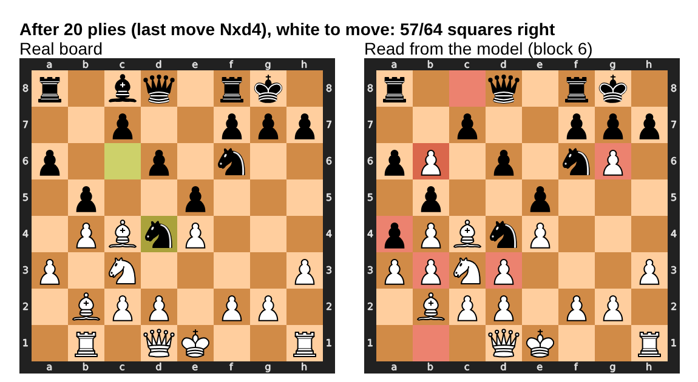
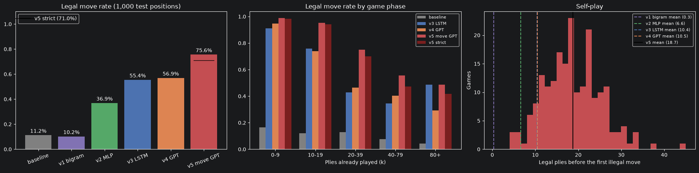
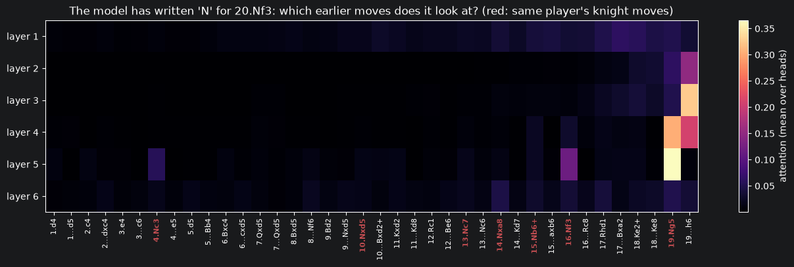
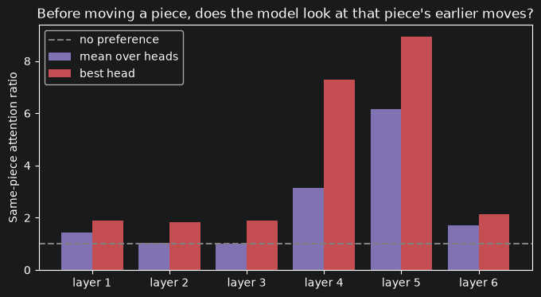
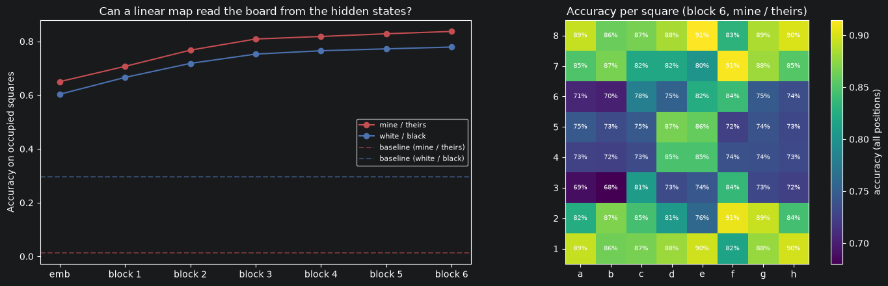

# ChessGPT

**A language model that learns chess only by reading games as text: from a bigram to a GPT that reconstructs the board inside its activations.**

No rules, no board, no engine: the model only ever sees move lists like `e4 e5 Nf3 Nc6 Bb5 …` from the [Lichess open database](https://database.lichess.org/). Its main test is the **legal move rate**: in 1,000 random positions from unseen games, how often is the move it proposes actually legal?

<p align="center">
  <br>
  <em>Left: the real position. Right: the board read out of ChessGPT's hidden states by a linear probe. Red squares are wrong.<br>The model was never shown a board: it reconstructed one from the moves.</em>
</p>

## Results

| Version | Model | Unit | Parameters | Bits/char ↓ | Legal move rate ↑ | Self-play plies ↑ |
|---|---|---|---|---|---|---|
| — | Frequency baseline | move | — | — | 11.2% | — |
| v1 | Bigram | character | 841 | 2.430 | 10.2% | 0.3 |
| v2 | MLP + embeddings (Bengio-style) | character | 475K | 1.558 | 36.9% | 6.6 |
| v3 | LSTM, written from scratch | character | 1.9M | 1.258 | 55.4% | 10.4 |
| v4 | GPT from scratch | character | 2.8M | 1.282 | 56.9% | 10.5 |
| **v5** | **GPT on move tokens** | **move** | **6.3M** | **1.019**\* | **75.6%** (87.8% greedy) | **18.7** |

\* For v5, the total information of each validation game divided by its number of characters, so it is comparable with the character models.
*Self-play: ChessGPT plays both sides; the number of legal moves before the first illegal one (mean of 200 games).*



## The journey

Each version fixes the main weakness of the previous one. Every notebook explains each step with the maths, and every line of code is commented.

| Version | Idea | What it fixed | Key concepts |
|---|---|---|---|
| [v1](notebooks/chessgpt_v1.ipynb) | Bigram, by counting and as a one-layer network | — (data pipeline and evaluation harness) | PGN parsing, character vocabulary, NLL / bits per character, legal move rate, self-play |
| [v2](notebooks/chessgpt_v2.ipynb) | MLP over a 16-character window | v1 sees one character | Embeddings, context window, temperature |
| [v3](notebooks/chessgpt_v3.ipynb) | LSTM | v2 forgets everything outside its window | Gates and cell state, BPTT, truncated BPTT, gradient clipping, incremental sampling |
| [v4](notebooks/chessgpt_v4.ipynb) | GPT (decoder-only Transformer) | v3 squeezes the whole game into one vector | Self-attention, causal mask, multi-head, pre-norm blocks, warmup + cosine, gradient accumulation, **attention maps**, **KV cache** |
| [v5](notebooks/chessgpt_v5.ipynb) | One move = one token, 3× more data | v4 must spell every move and sees only ~124 plies | Word-level vocabulary, length bucketing, token-budget batches, weight tying, strict legality, **linear probes** |
| [app](app/app.py) | Web app (Gradio) | v5 lives in a notebook | Constrained decoding (legal-move masking), live probe |

## Highlights

### 1. Attention learns to track pieces (v4)
When the character GPT has just written `N` for **20.Nf3**, layer 5 looks almost only at **19.Ng5** and **16.Nf3**: exactly the moves that tell where that knight is.



Measured over 11,567 piece moves: before moving a piece, **layers 4 and 5 attend to the earlier moves of the same piece and the same player 6–9 times more than chance**. Nobody told the model what a piece is.

<p align="center"></p>

### 2. The board is linearly readable from the activations (v5)
A linear classifier on the hidden states predicts the content of all 64 squares. Accuracy on occupied squares grows layer by layer, from 65% (embeddings only) to **83.7%** after the last block. The board is readable much better in **"mine / theirs"** form (pieces of the player to move vs. the opponent) than in "white / black", as found for Othello-GPT.



The picture is approximate: only about 3% of the boards are right on every square, and it gets blurrier as the game goes on.

### 3. Training on an 8 GB MacBook (Apple M1, `mps`)
Getting every model to train on a small laptop GPU was part of the work:
- `nn.LSTM` ran out of memory on `mps`, so the LSTM is **implemented from scratch**. Indexing `x[:, t]` inside the time loop made the backward pass O(T²); `unbind` fixed it.
- Slicing columns out of a large `uint8` tensor on the GPU returned **all zeros**: the model was silently training on garbage. Data now stays on the CPU, and an `assert` checks the first batch against the raw text.
- **Truncated BPTT** with 512 parallel streams turned 640 sequential steps per update into 64.
- **Gradient accumulation** and a **memory cap** (`torch.mps.set_per_process_memory_fraction`): an out-of-memory error instead of a frozen laptop.
- **Token-budget batches** with only **8 tensor shapes** (lengths rounded to multiples of 32): on `mps` every new shape compiles and keeps a new graph.

## Evaluation
- **Same 1,000 test positions** for all versions: random prefixes of held-out January 2013 games (fixed seed).
- **Legal**: `python-chess` accepts the move. **Strict** (from v5 on): the move must also be written exactly as `board.san(move)` writes it. While analysing v4, I found that `parse_san` ignores a wrong `x`, `+` or `#`: `Bxe4` with nothing on e4 counts as legal.
- **p(legal)** (v5): the total probability the model puts on legal moves, which measures legality without sampling noise. For v5 it is 70.2% (98.5% in the opening).
- **By game phase**: 0–9, 10–19, 20–39, 40–79 and 80+ plies already played.
- **Caveats**:
  - the v3 training cell was run twice (6 epochs instead of 3);
  - v5 changes three things at once (move tokens, 3× data, a bigger model), so the gain is not attributed to any single one.

## Play

The app lets you play against the v5 model, **clicking a piece and then the square where it should go**:
- an option to let ChessGPT choose **only among legal moves** (masking) or **freely**, in which case it sometimes tries illegal moves;
- a temperature slider;
- its 8 favourite candidate moves, with their probabilities;
- **the board it "sees"** through the linear probe, updated live.

**Run it** (after running `chessgpt_v5.ipynb`, which saves the model and the probe):
```bash
pip install -r requirements.txt
python app/app.py            # then open http://127.0.0.1:7860
python app/app.py --share    # temporary public link (about 72 hours) to let friends play from their phone
```

## Reproduce

```bash
git clone https://github.com/costafede/ChessGPT.git
cd ChessGPT
python -m venv .venv && source .venv/bin/activate
pip install -r requirements.txt
```

Run the notebooks **in order** from the `notebooks/` folder. The data (Lichess, January to March 2013, about 60 MB compressed) is downloaded automatically into `notebooks/data/lichess/`, which git ignores.

| Notebook | Approximate time on an 8 GB M1 |
|---|---|
| v1 | a few minutes (download + parsing) |
| v2 | ~5–10 min |
| v3 | ~35 min |
| v4 | ~50 min |
| v5 | ~35 min (+ ~1 min to download the extra months) |

The results of every version are collected in `notebooks/data/lichess/chessgpt_results.json`, so each notebook compares itself with the previous ones. v5 can also run on Google Colab: see the note at its top.

## Repository structure
```
ChessGPT/
├── notebooks/          chessgpt_v1.ipynb … chessgpt_v5.ipynb
├── app/                app.py (the web app)
├── assets/             figures for this README
├── requirements.txt
└── README.md
```

## Limitations and next steps
- At temperature 1, about 29% of v5's moves are still strictly illegal, and its internal board is rarely exact. More data (Lichess publishes years of games), a bigger model and a real GPU would push both.
- ChessGPT has no search and no evaluation: it continues games "the way games usually go", so simple tactics beat it.
- Next experiments:
  - ablations separating the effects of tokens, data and model size;
  - probes for more abstract concepts (checks, attacked squares);
  - using the probe direction to **edit** the model's internal board.

## References
- Lichess open database, CC0: https://database.lichess.org/
- Bengio et al., *A Neural Probabilistic Language Model*, 2003.
- Hochreiter & Schmidhuber, *Long Short-Term Memory*, 1997.
- Vaswani et al., *Attention Is All You Need*, 2017; Radford et al., *Language Models are Unsupervised Multitask Learners* (GPT-2), 2019.
- Karpathy, *char-rnn* and *nanoGPT*.
- Toshniwal et al., *Chess as a Testbed for Language Model State Tracking*, 2022.
- Li et al., *Emergent World Representations: Exploring a Sequence Model Trained on a Synthetic Task* (Othello-GPT), 2023; Nanda et al., *Emergent Linear Representations in World Models of Self-Supervised Sequence Models*, 2023.
- Karvonen, *Emergent World Models and Latent Variable Estimation in Chess-Playing Language Models*, 2024.
